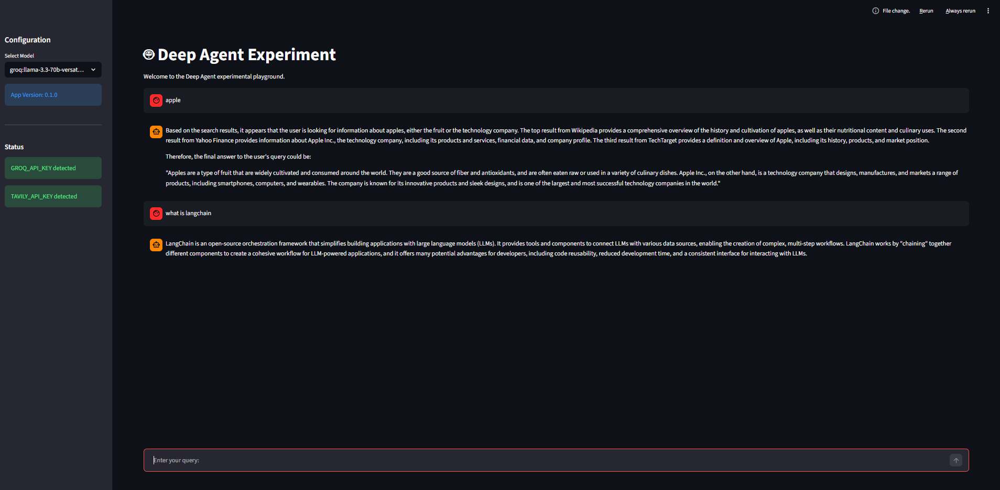

# Deep Agent

A quick experiment on AI research assistant built with Python and Streamlit.

This project lets you chat with a deep agent that can choose a model and use web search to answer questions.

